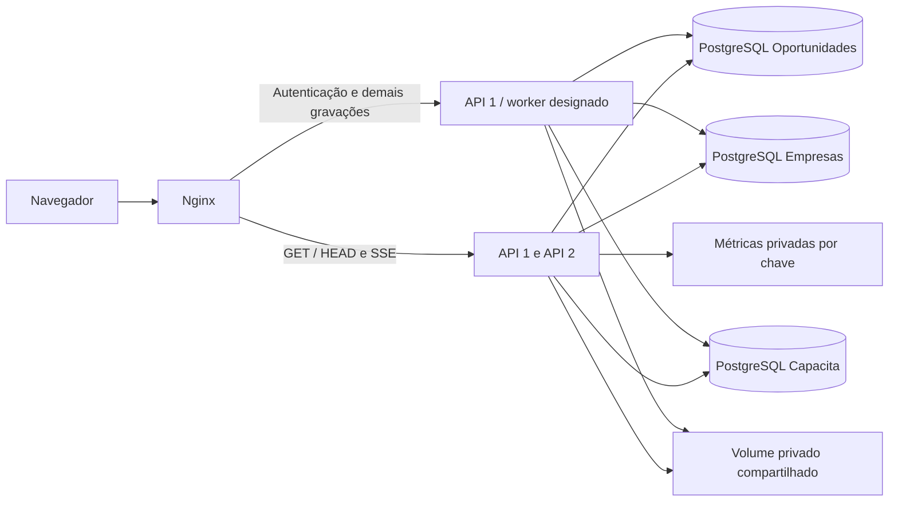

# Operação, escala e recuperação da Trampolim

Esta configuração prepara distribuição de leituras e notificações. **Não certifica 5.000 usuários, 1.000 RPS, alta disponibilidade completa ou distribuição por CDN.** Os arquivos são uma base local verificável; não houve implantação de produção.

## Componentes e limites

Cada instância mantém os mesmos três segredos por trilha que as demais instâncias, mas Oportunidades, Empresas e Capacita nunca reutilizam a mesma chave entre si. Cada DataSource possui seu próprio banco, usuário e pool. Não há autenticação compartilhada.

O proxy encaminha autenticação, alterações, publicação e uploads somente à API 1. Isso preserva os limitadores e semáforos ainda locais, em vez de permitir multiplicação das cotas por réplica. API 2 recebe leituras. Não publique as portas das APIs ou dos bancos na internet. A falha da API 1 exige recuperação operacional das gravações; este desenho ainda não oferece failover automático seguro de todos os comandos.

`CATALOG_JOBS_ENABLED=true` em exatamente uma instância executa manutenção e e-mails do catálogo. Nas outras deve ser `false`. Processamento disparado durante a publicação permanece na implementação existente; o parâmetro não cria uma fila distribuída. Os serviços educacionais de limpeza usam os bancos/arquivos privados e permanecem idempotentes, mas precisam de observação operacional.

## Execução local opcional

1. Inicie os bancos existentes com `docker compose -f backend/docker-compose.yml up -d` a partir da raiz, ajustando o nome da rede se o projeto Compose tiver outro nome.
2. Copie `ops/.env.example` para `ops/.env.local`, sem sobrescrever um arquivo já configurado. Preencha as conexões e os segredos locais. `APP_CORS_ALLOWED_ORIGINS` precisa conter as origens exatas do navegador (no exemplo, localhost/127.0.0.1 na porta 8088); o proxy preserva Host e porta. Em produção utilize os domínios HTTPS autorizados. O arquivo privado é ignorado pelo Git.
3. Confira a rede criada pelo Compose. No ambiente auditado é `backend_default`. Configure `DATABASE_NETWORK` quando necessário. Os nomes `postgres`, `postgres-empresas` e `postgres-capacita` são resolvidos nessa rede privada; usam porta interna 5432.
4. Execute `docker compose --env-file ops/.env.local -f ops/compose.local.yml config --quiet`.
5. Havendo recursos disponíveis, execute `docker compose --env-file ops/.env.local -f ops/compose.local.yml up --build -d` e abra `http://localhost:8088`.

**O build completo das imagens e a subida desse conjunto não foram executados nesta auditoria.** Foram verificados o Compose e a sintaxe Nginx em contêiner. A compilação Java/React foi executada diretamente na máquina. Não use credenciais de exemplo fora do desenvolvimento. A configuração local de e-mail desativado não é uma configuração de produção.

Os bancos de desenvolvimento passam a publicar portas em `127.0.0.1` por padrão; a alteração só entra em vigor quando os contêineres forem recriados. A comunicação entre contêineres continua pela rede privada. Não execute `down -v`: isso apagaria volumes existentes.

## Orçamento de conexões e recursos

Por instância, cada pool tem máximo 10 e mínimo 1, com espera de aquisição de 5 s e validação de 2 s. São configurações iniciais, não números dimensionados para produção. Cada banco precisa reservar `número de instâncias × máximo do seu pool`, além de migrações, administração, backups e workers. Não aumente simultaneamente instâncias e pools sem medir conexões ativas, espera, CPU e locks.

Os contêineres de API têm limite inicial de 2 GiB, JVM com 40% da memória para heap e margem para bibliotecas nativas, FFmpeg e workers PDF. Esses valores precisam ser validados com uploads reais; não constituem garantia de ausência de OOM. O upload e processamento de mídia continuam limitados por semáforos. Para crescimento, separe a capacidade de processamento da capacidade HTTP após implementar uma fila persistente com lease, idempotência e retentativas.

`server.shutdown=graceful`, prazo 30 s; Compose aguarda 40 s. O SSE fecha e reconecta com cursor persistido. O tempo de desligamento deve incluir drenagem do balanceador e observação de pedidos em andamento.

## Métricas e probes

Actuator fica em `127.0.0.1:9001` por padrão. No Compose fica acessível apenas na rede dos serviços, sem porta publicada. Liveness e readiness não exibem detalhes. Readiness verifica o estado da aplicação; não desativa todo o ecossistema porque um banco secundário caiu. `/api/health` preserva os estados específicos das três trilhas. Monitore ambos.

`/actuator/prometheus` exige `X-Monitoring-Key`, no mínimo 32 caracteres, com comparação em tempo constante. Chave ausente ou incorreta retorna 403. Demais endpoints Actuator não são publicados. Não exponha esse cabeçalho no frontend. Uma chave de monitoramento é diferente dos três segredos JWT.

São coletadas métricas HTTP, histogramas, JVM, sistema e pools; SSE adiciona conexões, capacidade, envios em andamento, duração e falhas do polling. Não há tags de e-mail, estudante, empresa, tokens ou query strings. O filtro cria `X-Request-ID`, disponibilizado por CORS, e registra falhas/lentidão sem corpo, URL privada ou credenciais. Os logs da aplicação usam campos chave/valor; não é tracing distribuído completo.

`ops/prometheus.example.yml` e `ops/alerts.example.yml` são exemplos para configurar uma instância privada de Prometheus; ela não foi instalada nem executada. O arquivo de chave fica em secret separado. Ajuste alertas por endpoint, separando SSE, mídia e processamento pesado dos objetivos de 500 ms para consultas comuns. Retenção de logs deve ser definida institucionalmente. Nginx omite URL/query/cabeçalhos dos access logs e reduz logs de erro que poderiam expor URLs privadas.

## Arquivos, SSE, cache e tarefas

O volume `private_media` é compartilhado entre réplicas locais. Em múltiplas máquinas, substitua-o por armazenamento privado compartilhado compatível ou implemente object storage com autorização, URLs temporárias, Range, revogação e testes. Não basta substituir um caminho local por uma URL pública. A distribuição atual de vídeo/PDF ainda passa pelo backend; tráfego de mídia não foi incluído nos números de RPS.

O banco Capacita é a fonte persistente das notificações. Cada nó consulta somente os destinatários de suas conexões, revalida conta/versão de token e avança cursores por canal. Entrega entre nós, recuperação offline e revogação foram testadas com duas instâncias. O limite padrão permanece 500 canais por nó e 2 por usuário **por nó**; não foi comprovada capacidade de 5.000 conexões. O limite de 20 SSE por IP no proxy é inicial e pode bloquear turmas atrás do mesmo NAT; revise-o junto de um limite global por identidade antes de uso institucional amplo.

Não foi adicionado Redis/RabbitMQ sem um consumidor completo e necessidade medida. Não há fila persistente nova, DLQ, object storage ou CDN configurados. O cache implementado é o dos assets com hash por um ano e `immutable`; HTML precisa de revalidação, APIs e mídia privada usam `no-store`. Não há cache de permissões, sessões ou resultados privados que possa atrasar revogação ou vazar dados entre trilhas. Cache público dinâmico só deve ser adicionado com invalidação de publicação, expiração e pagamento.

## Backups, migrações e restauração

Faça backups independentes dos três bancos com `pg_dump -Fc`, protegidos e criptografados fora do repositório. Em Windows PowerShell antigo, não redirecione o fluxo binário de `pg_dump` com `>`: grave com `--file` e copie o arquivo. Inclua configurações, versões aplicadas e um snapshot consistente do volume privado de mídia. Não registre segredos em logs ou comandos compartilhados.

Ensaie restauração em três bancos novos e isolados, com usuários diferentes dos de produção. Use `pg_restore --no-owner --exit-on-error` sem `--clean` e confira as contagens, integridade, Flyway, autenticação, arquivos e notificações. A restauração de produção requer um procedimento autorizado e validado; não foi executada. RPO/RTO, retenção e acesso aos backups dependem de decisão operacional.

As migrações novas são Capacita V15 e Empresas V10. São índices aditivos; nenhuma tabela, registro ou migração histórica foi removida. Em tabelas grandes, a criação convencional de índice pode bloquear gravações: planeje janela e timeout, ou uma migração não transacional `CONCURRENTLY` específica e validada antes de aplicar em produção. Não edite uma versão já aplicada. Em rollback da aplicação, os índices podem permanecer; remoção deve ocorrer em migração posterior autorizada.

## Critérios para a próxima escala

Antes de liberar milhares de usuários: homologar os cenários reais com dados representativos; concluir a paginação dos contratos legados e relatórios de maior volume; tornar cotas globais e agendamento resistentes a failover; desacoplar e-mails/relatórios/processamento pesado com outbox e workers persistentes; validar mídia compartilhada ou object storage; TLS, CORS restrito, segredos, backups e restauração; alertas e ensaios de falha. Pin de imagens por digest e análise de vulnerabilidades Java/container fazem parte da preparação de produção.

Compose é suficiente para uma demonstração controlada. Um serviço gerenciado de contêineres com balanceador e PostgreSQL gerenciado pode ser avaliado antes de Kubernetes. Não há estimativa de custo confiável sem região, SLA, armazenamento, tráfego de vídeo e carga reais. Nenhum recurso pago foi criado.

Referências: [Spring Boot Actuator](https://docs.spring.io/spring-boot/reference/actuator/monitoring.html), [k6 thresholds](https://grafana.com/docs/k6/latest/using-k6/thresholds/), [k6 constant arrival rate](https://grafana.com/docs/k6/latest/using-k6/scenarios/executors/constant-arrival-rate/).
